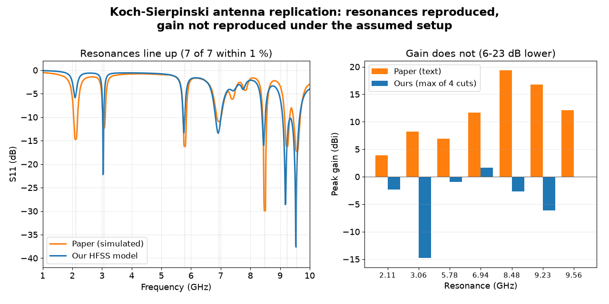
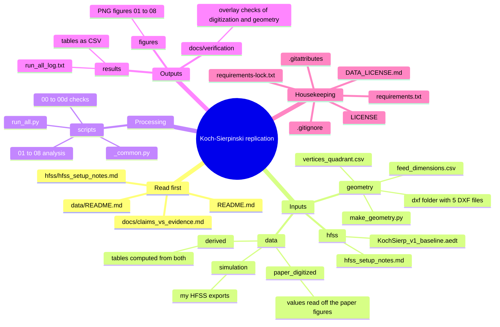

# Koch-Sierpinski antenna replication

Simulation-only replication of a hybrid Koch-Sierpinski fractal antenna: Azzouz et al., *Fractal Fract.* 2026, 10, 47 ([doi:10.3390/fractalfract10010047](https://doi.org/10.3390/fractalfract10010047)). Ansys HFSS and Python.



## Summary

The paper does not state the ground plane, port, radiation box, copper thickness or excitation power, and gives the outline only as a figure. I rebuilt the geometry from the paper's Figs 1-2 (to about 0.05 mm), assumed a standard setup (below), and compared my HFSS results with the paper's text, digitized curves and figures.

Under this setup:

- **Reproduced:** all 7 reported resonance frequencies, within 1.0 % (largest difference 0.95 %; setup-dependent at about this level, see Assumptions). The iteration study of Fig 4 for iterations 0-2: every dip at or below -10 dB has one of mine within 2 % in frequency.
- **Not reproduced:** the S11 depths at some bands (2.11 GHz: -5.8 dB vs -14 reported; 8.48 GHz: -12.6 dB vs -30), the Fig 7 features of the Koch-only variant, and the reported gain. The paper reports 3.92-19.38 dBi at the seven resonances. My peak gain never exceeds +4.45 dBi and my peak directivity never exceeds 9.28 dBi between 1 and 10 GHz. Radiation efficiency is 1.5-34.8 %.

"Not reproduced" means my model disagrees under assumptions the paper does not confirm. It does not show the paper is wrong. The details, with the file and script behind every number, are in [`docs/claims_vs_evidence.md`](docs/claims_vs_evidence.md).

## Where to start (pick your question)

| I want to... | Open this |
|---|---|
| Read the full write-up | docs/replication_report.pdf |
| Get the verdict in 2 minutes | This README: *Summary* above and *Results at a glance* below |
| See every claim, its evidence file, script and confidence | [`docs/claims_vs_evidence.md`](docs/claims_vs_evidence.md) |
| Know exactly what I assumed in HFSS | *Assumptions* below and [`hfss/hfss_setup_notes.md`](hfss/hfss_setup_notes.md) |
| Check one paper figure | *Status by figure* below, then the figure and table with the same number in `figures/` and `results/` |
| Reuse the data (CSV) | [`data/README.md`](data/README.md): one entry per file, with every column explained |
| Re-run all the analysis | *Reproduce* below (`python scripts/run_all.py`) |
| Rebuild the antenna in my own solver | `geometry/` (DXF files, vertex table, generator script) and `hfss/hfss_setup_notes.md` |
| Open the HFSS project | `hfss/KochSierp_v1_baseline.aedt` (needs ANSYS HFSS; the free Student version works) |
| Find out how a number was made | *Trace a number* below |
| Reuse or cite this work | *Licences and credits* at the end |

## Repository map

The picture below shows the five blocks of the repository. Data flows from left to right: **inputs** (geometry, HFSS project, data files) are processed by **scripts** into **outputs** (`results/`, `figures/`), and the claims table connects the outputs to the statements made in this README.



### Annotated file tree

```
koch-sierpinski-antenna-replication/
│
├── README.md                    <- this file: overview, results, how to use the repository
├── LICENSE                      <- MIT licence (code)
├── DATA_LICENSE.md              <- CC BY 4.0 (simulation data, tables, figures) + credit for digitized paper data
├── requirements.txt             <- Python packages needed (loose versions)
├── requirements-lock.txt        <- exact package versions used (use this one to reproduce)
├── .gitignore  .gitattributes   <- Git housekeeping, nothing scientific
│
├── docs/
|   ├── replication_report.pdf <- full write-up: method, results by figure, limits.
│   ├── claims_vs_evidence.md    <- THE reference table: every claim -> evidence file -> script -> status -> confidence
│   └── verification/            <- overlay checks: my digitized curves and my geometry drawn on top of
│                                   the paper's figures (report .txt, edge table .csv, overlay .png images)
│
├── geometry/                    <- the antenna outline, rebuilt from the paper's Figs 1-2
│   ├── vertices_quadrant.csv    <- 13 outline vertices of one quadrant (mm); the other three are mirrored
│   ├── make_geometry.py         <- builds all five DXF files and runs 26 self-checks
│   ├── feed_dimensions.csv      <- feed rectangle per design (the DXF files contain no feed)
│   └── dxf/                     <- one DXF per design, layers PATCH (outline) and HOLES (slots)
│       ├── Iter0_triangle.dxf               single triangle
│       ├── Iter1_triangle_slot5.dxf         + 5 mm central slot
│       ├── Iter2_hexagram_carpet2.dxf       hexagram + 5 mm slot + eight 5/3 mm slots
│       ├── KochSierpinski_patch_v3_nofeed.dxf   final design (48-vertex outline + 73-slot carpet)
│       └── KochOnly_noslots.dxf             final outline without slots (Fig 7 variant)
│
├── hfss/
│   ├── KochSierp_v1_baseline.aedt   <- baseline HFSS project (geometry and setup only, no stored results)
│   └── hfss_setup_notes.md          <- every HFSS setting: confirmed, as built, or assumed; solver convergence numbers
│
├── data/                        <- all numbers behind the figures (column dictionary: data/README.md)
│   ├── README.md
│   ├── paper_digitized/         <- values I read off the paper's figures (about +-1 dB), NOT the authors' data
│   │   ├── paper_s11_final_simulated_digitized.csv   Fig 5, simulated S11 of the final design
│   │   ├── paper_fig4_s11_iter0-3_digitized.csv      Fig 4, S11 of iterations 0-3
│   │   ├── paper_fig11_gain_vs_freq_digitized.csv    Fig 11, gain vs frequency
│   │   └── paper_fig9_patterns_raw_pixels.csv        Fig 9 patterns, radius in pixels (uncalibrated)
│   ├── simulation/              <- my HFSS exports (assumed setup, see Assumptions)
│   │   ├── sim_s11_vswr_final_design.csv             final design S11 and VSWR, 1-12 GHz
│   │   ├── sim_s11_iter0-3_and_koch_only.csv         iterations 0-3 and the Koch-only variant
│   │   ├── sim_s11_feed_width_sweep.csv              sensitivity: feed width 1.5 / 1.73 / 1.8 mm
│   │   ├── sim_s11_radiation_box_pad20mm.csv         sensitivity: 20 mm radiation box
│   │   ├── sim_s11_copper_loss.csv                   sensitivity: finite-conductivity copper
│   │   ├── sim_s11_port_7x4mm.csv                    sensitivity: smaller wave port
│   │   ├── sim_s11_lumped_port.csv                   sensitivity: lumped port
│   │   ├── sim_farfield_summary_1-10GHz.csv          peak gain, directivity, efficiency, 91 frequencies
│   │   ├── sim_gain_cuts_adaptive_freqs.csv          gain cuts at 2.11, 5.78, 9.56 GHz
│   │   └── sim_gain_cuts_discrete_freqs.csv          gain cuts at 8 further frequencies
│   └── derived/                 <- tables computed from the two groups above
│       ├── fig9_peak_levels_paper_vs_sim.csv         Fig 9 peak levels vs text vs mine
│       └── fig9_convention_scan.csv                  angle-convention test for the Fig 9 shapes
│
├── scripts/
│   ├── 00_verify_data.py                <- 133 checks: data files, column meanings, numbers quoted in the notes
│   ├── 00b_overlay_check.py             <- 68 checks: digitized curves lie on the paper's drawn curves
│   ├── 00c_geometry_overlay_check.py    <- 64 checks: my geometry lies on the paper's Figs 1-2
│   ├── 00d_verify_results.py            <- 64 checks: README facts and headline numbers match results/
│   ├── 01_s11_final_vs_paper.py         <- 7 resonances, depths, bandwidths, RMSE
│   ├── 02_fig4_iterations.py            <- Fig 4: dips, counts, RMSE per iteration
│   ├── 03_fig7_koch_only.py             <- Fig 7 claims vs the Koch-only model
│   ├── 04_fig8_vswr.py                  <- Fig 8: VSWR at the 7 frequencies
│   ├── 05_gain_and_efficiency.py        <- Figs 9-11: gain, directivity, efficiency, aperture yardstick
│   ├── 06_fig9_patterns.py              <- Fig 9: levels and the angle-convention test with a null
│   ├── 07_make_hero_figure.py           <- the 1280 x 640 figure at the top of this README
│   ├── 08_sensitivity_sweeps.py         <- setup-sensitivity cases (feed, box, copper, ports)
│   ├── _common.py                       <- shared loaders, dip finder, plotting helpers (not run directly)
│   └── run_all.py                       <- runs 00, 01-08, 00d in order; expected last line: ALL OK
│
├── figures/                     <- PNG output of the scripts; the number matches the script (01 <- 01_...py)
│   └── 01_s11_final_vs_paper  02_fig4_iterations  03_fig7_koch_only  04_fig8_vswr
│       05_gain_and_efficiency  06_fig9_patterns  07_hero_figure  08_sensitivity_sweeps
│
└── results/                     <- numeric output of the scripts (CSV), same numbering
    ├── 01_s11_resonances.csv
    ├── 02_fig4_dips.csv  02_fig4_summary.csv
    ├── 03_fig7_claims.csv  03_fig7_dips.csv
    ├── 04_vswr_at_paper_frequencies.csv
    ├── 05_gain_at_paper_frequencies.csv  05_farfield_summary_stats.csv
    ├── 06_fig9_levels.csv  06_fig9_null_test.csv
    ├── 08_sensitivity_dips.csv  08_sensitivity_summary.csv
    └── run_all_log.txt          <- full console output of the last run_all.py
```

### How the pieces connect

```
paper figures ──(digitize)──> data/paper_digitized/ ─┐
                                                     ├──> scripts/01-08 ──> results/*.csv + figures/*.png ──> docs/claims_vs_evidence.md ──> README
Figs 1-2 ──(read vertices)──> geometry/ ──(import)──> HFSS ──(export)──> data/simulation/ ─┘
                                                      ^
                                           hfss/hfss_setup_notes.md (what was assumed)
```

Rule of thumb: **`data/` holds inputs, `results/` and `figures/` hold outputs, `docs/claims_vs_evidence.md` holds the interpretation.** Nothing in `results/` or `figures/` is edited by hand; delete them and `run_all.py` recreates them.

## Results at a glance

**Resonances (final design).** Paper values are from its text; mine are the S11 dips of my baseline model. Source: `results/01_s11_resonances.csv`.

| Paper (GHz) | 2.11 | 3.06 | 5.78 | 6.94 | 8.48 | 9.23 | 9.56 |
|---|---|---|---|---|---|---|---|
| My dip (GHz) | 2.09 | 3.04 | 5.76 | 6.92 | 8.45 | 9.18 | 9.54 |
| Difference | 0.95 % | 0.65 % | 0.35 % | 0.29 % | 0.35 % | 0.54 % | 0.21 % |
| Paper return loss (dB) | -14 | -12 | -16 | -10 | -30 | -16 | -17 |
| My dip depth (dB) | -5.8 | -22.2 | -13.3 | -13.4 | -16.0 | -28.6 | -37.6 |

**Gain.** Paper text vs my maximum over the four exported phi cuts (a lower bound of the true peak; see Limitations). Source: `results/05_gain_at_paper_frequencies.csv`.

| Frequency (GHz) | 2.11 | 3.06 | 5.78 | 6.94 | 8.48 | 9.23 | 9.56 |
|---|---|---|---|---|---|---|---|
| Paper text (dBi) | 3.92 | 8.24 | 6.90 | 11.66 | 19.38 | 16.76 | 12.06 |
| Mine, cut maximum (dBi) | -2.32 | -14.81 | -0.97 | +1.61 | -2.70 | -6.15 | -0.06 |

Over the whole 1-10 GHz sweep my peak gain is at most +4.45 dBi and my peak directivity at most 9.28 dBi. These numbers depend on the assumed setup, and an S11 match does not validate gain.

## Status by figure

| Paper figure | Status |
|---|---|
| Figs 1-2 (geometry) | Reconstructed from the figures; overlay check passes (64 checks). The geometry of Fig 2, not the paper's text description of the iterations, is the one consistent with Fig 4. |
| Fig 3 (photograph) | Not applicable (simulation only) |
| Fig 4 (iterations) | Iterations 0-2 match in dip frequency (within 2 %) and approximately in depth. Iteration 3 (final design) differs in depth at 2.11 and 8.48 GHz. |
| Fig 5 (simulated S11) | Compared; resonance frequencies agree, depths do not. The measured curve is not a replication target. |
| Fig 6 (mesh refinement) | Not replicable: the meaning of the values 0.005 / 0.0025 / 0.00125 mm is not stated. |
| Fig 7 (Koch-only) | Not reproduced under this setup. |
| Fig 8 (VSWR) | Compared at the 7 frequencies; 2 of 7 values agree within 0.1. |
| Fig 9 (patterns) | Peak levels: the paper's Fig 9 matches its text gains; mine are 6-23 dB lower. Shapes: inconclusive (the angle convention is not stated). |
| Fig 10 (3D gain) | Peak values compared; not reproduced. |
| Fig 11 (gain vs frequency) | Not reproduced. It also disagrees with the paper's text gains by 1.7-13.7 dB at the 7 resonances. |
| Fig 12 (surface currents) | Not compared numerically (palette mapping has medium-low confidence; excitation power unknown). |
| Table 1 | Not a replication target |

## Assumptions

These are mine, not the paper's. Results depend on them, most of all the gain.

| Item | Used |
|---|---|
| Substrate | FR4, relative permittivity 4.7, loss tangent 0.0197, 0.8 mm, board 60 x 40 mm (from the paper) |
| Ground plane | Full, 60 x 40 mm, Perfect E |
| Conductors | Perfect E, zero thickness |
| Port | Wave port on the board edge, renormalised to 50 ohm |
| Radiation box | 37.5 mm padding, radiation boundary |
| Solver | HFSS 2025 R2 Student (the paper used v15), multi-frequency adaptive mesh at 2.11, 5.78, 9.56 GHz, interpolating sweep 1-12 GHz |

Full list, including solver convergence numbers: [`hfss/hfss_setup_notes.md`](hfss/hfss_setup_notes.md). Feed width, radiation-box size, finite-conductivity copper, port size and port type (lumped instead of wave port) did not close the S11 depth gaps at 2.11 and 8.48 GHz. The dip frequencies do depend on the port: a 7 x 4 mm wave port moves them down by up to 1.6 %, but that run also converged on a coarser mesh (17,531 vs 39,514 tetrahedra), so port size and mesh are not separated (`results/08_sensitivity_summary.csv`).

## Limitations

- One solver and one assumed setup; one simulation per design. An independent solver (for example openEMS) has not been run.
- The HFSS Student licence limits the mesh to about 40,000 tetrahedra (final design: 39,514), so the mesh could not be refined much.
- Gain cuts were exported for four phi planes only, so the "cut maximum" values are lower bounds of the peak gain (the true peaks at 9.18-9.56 GHz are 0.4-2.5 dB higher).
- Peak directivity is below 0 dBi at 17 of 91 frequencies (1.0-1.4 and 3.3-4.4 GHz), which is physically impossible. The cause is unresolved. The paper's seven resonances are not among the affected frequencies (the nearest, 3.06 GHz, lies just below the 3.3-4.4 GHz range), but because the cause is unknown, values near the affected range should be treated with caution.
- Digitized paper values carry about +-1 dB uncertainty. The angle convention of the paper's Fig 9 is not stated.
- In Fig 2 the horizontal edges of the iteration 0-2 shapes lie about 0.08 mm inside my geometry; the effect on S11 was not tested.
- Far-field values are sampled on a 5 deg (phi) x 1 deg (theta) grid, so a narrow lobe between grid points could be slightly higher than reported. Setup details: `hfss/hfss_setup_notes.md`.

## Reproduce

Developed on Python 3.14 and Windows. From the repo root:

```
py -3.14 -m venv .venv
.venv\Scripts\Activate.ps1
pip install -r requirements-lock.txt
python scripts/run_all.py
```

`run_all.py` runs the data check, analysis scripts 01-08 and the results check, writes the figures to `figures/` and the tables to `results/`, and keeps `results/run_all_log.txt`. Expected last line: `ALL OK`. Inputs are found by file name anywhere below `data/`; use `--data-dir` for another folder.

Every script prints the file it loaded, so the console output shows which data each number came from. To run one analysis alone, for example the S11 comparison: `python scripts/01_s11_final_vs_paper.py --data-dir data`.

Other checks:

```
python geometry/make_geometry.py --check-only
```

Rebuilds the geometry in memory and runs 26 self-checks. Without `--check-only` it rewrites `geometry/dxf/`.

`scripts/00b_overlay_check.py` and `scripts/00c_geometry_overlay_check.py` need the paper's figure images, which are not included here. Download the paper (open access) and see each script's header for the arguments.

What the checks cover: 133 data checks, 64 results checks, 68 digitization overlay checks, 64 geometry overlay checks, 26 geometry self-checks. They show that files, notes and results agree with each other. They do not show that an interpretation is right.

## Trace a number

Every number in this README can be followed back to a data file in four steps. Example: "2.11 GHz: -5.8 dB".

1. **Claim:** find it in [`docs/claims_vs_evidence.md`](docs/claims_vs_evidence.md) (here: row 1.2). The row names the evidence file, the script, the status and the confidence.
2. **Result table:** open the evidence file (here `results/01_s11_resonances.csv`).
3. **Script:** open the script named in the row (here `scripts/01_s11_final_vs_paper.py`). Its header states the method, tolerances and inputs.
4. **Raw data:** open the input file (here `data/simulation/sim_s11_vswr_final_design.csv`). Column meanings are in [`data/README.md`](data/README.md).

To read a value yourself:

```python
import pandas as pd

s11 = pd.read_csv("data/simulation/sim_s11_vswr_final_design.csv")
row = s11.loc[(s11["Freq [GHz]"] - 2.11).abs().idxmin()]
print(row["Freq [GHz]"], row["dB(S(1,1)) []"])   # about -5.6 dB at 2.11 GHz; the dip itself is -5.8 dB at 2.09 GHz
```

How to read the **status** words in the claims table: *Reproduced* = my model agrees within the stated tolerance; *Not reproduced (this setup)* = it disagrees, which does not show the paper is wrong; *Observation* = a measured fact without a verdict; *Inconclusive* = the test cannot separate the hypotheses; *Not checkable here* = the evidence is not stored in this repository.

## Licences and credits

- Code: MIT (`LICENSE`). Simulation data, tables and figures: CC BY 4.0 (`DATA_LICENSE.md`).
- `data/paper_digitized/` and the images in `docs/verification/` are derived from figures of Azzouz et al. (2026), published under CC BY 4.0. They are my digitizations and overlays, not the authors' data; please credit the original authors as well.
- The `.aedt` project needs ANSYS HFSS to open (a free Student version exists).

## Original paper

Azzouz, A.; Bouhmidi, R.; Munir, M.E.; Nasralla, M.M.; Chetioui, M. Characterization and Analysis of Hybrid Fractal Antennas for Multiband Communication and Radar Applications. *Fractal Fract.* **2026**, *10*, 47. https://doi.org/10.3390/fractalfract10010047

Questions about the unstated setup details were sent to the corresponding author on 31 October 2026. This note will be updated if there is a reply.

Author of this replication: Abdul Jabbar Khan, undergraduate, ECE, RGUKT Nuzvid.
